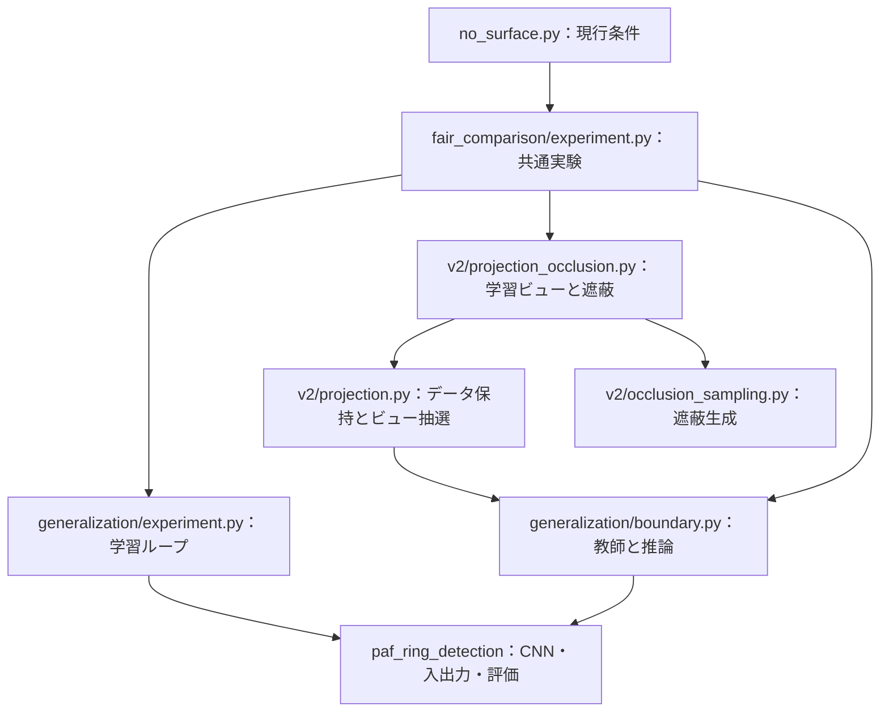

# Kenkyuu 現行システム構成と再現範囲

確認日：2026-11-20（JST）。対象：`codex/hole-region-comparison` の作業ツリー。

この資料は、現行実装の役割・依存関係・操作入口と、最小構成へ引き継ぐ範囲をまとめるものです。個々の生成画像・推定行は列挙せず、ソースファイル、実験、データ集合、結果の種類を単位に整理しています。研究方針の正本は [RESEARCH_HANDOFF.md](.codex/RESEARCH_HANDOFF.md) です。

## 1. 現在の中心

研究の問いは「特定機体の詳細CADを使わず、多様な合成PAFで学習したCNNで、学習に含めない1194Mの内周を欠損に強く検出できるか」です。

現行の検出器は **単一のTiny U-Net16 → 境界確率 → 二値化・中心線化 → 確率重み付きRANSAC → 内周楕円** です。比較対象は1194M学習CNN、多様形状学習CNN、Canny＋輪郭別RANSAC、Zhang 2019型（再現実装）の4方式です。CNNの3seed平均は、3モデルを合成する検出器ではなく、別々に学習した3回の成績平均です。

現在の結果には次の二つの評価仕様があります。

|評価仕様|通常・遮蔽・黒つぶれ|白飛び|数値の正本|
|---|---|---|---|
|現行モデルの基本比較|固定した13条件の該当部分|元の強度範囲|`output/paf_1194m_no_surface_v1/`|
|最新発表の比較|基本比較を使用|内部強度範囲を2倍にした4条件へ置換。再学習なし|基本比較＋`output/paf_whiteout_strength_3seed_v1/`|

|評価仕様・評価対象|1194M学習CNN|多様形状学習CNN|Canny＋輪郭別RANSAC|Zhang 2019型（再現実装）|
|---|---:|---:|---:|---:|
|基本比較・1194M|81.87%|71.34%|49.18%|46.91%|
|基本比較・多様形状|58.16%|74.84%|53.00%|61.24%|
|発表比較・1194M|79.97%|67.88%|46.09%|42.99%|
|発表比較・多様形状|55.48%|72.14%|49.90%|56.19%|

いずれも全13条件の成功率です。成功条件は正解と推定の**楕円内部を塗りつぶした領域のIoU ≥ 0.8**。未検出も分母に含めます。境界線幅3pxの重なりを測る指標ではありません。発表の統合数値は `研究関連書類/進捗報告会_202610/figures/白飛び3seed/図データ.json` にあります。

前段v2の71.41%／74.86%は別の評価入口で保存した値です。現行基本比較の71.34%／74.84%と混在させません。共通評価入口の乱数・一様画像処理を含む評価仕様を固定して再現する必要があります。

## 2. 検出器の構成部品

|処理|役割|現行実装|
|---|---|---|
|画像と正解の読込|manifestの画像参照、正解楕円、画像座標の変換|`paf_ring_detection/data.py`|
|撮像劣化|矩形遮蔽・白飛び・黒つぶれを元の480px画像に適用|`paf_ring_detection/effects.py`|
|前処理|グレースケール化、同じ輝度を3chに複製、256pxへ縮小、[-1,1]へ正規化|`data.py`、`research/paf_generalization/diagnose.py`等|
|CNN|境界確率を推定するTiny U-Net16。482,737パラメータ|`paf_ring_detection/methods/cnn.py`|
|教師生成・損失|完全穴領域から約2pxの境界を作り、既知の矩形遮蔽を除く。正例重み12のBCE＋Dice|`research/paf_generalization/boundary.py`|
|点群化|確率0.5以上を二値化し、形態学的スケルトンを作る。元の確率を点の重みにする|同上の`skeleton_points`|
|楕円推定|450仮説、距離2px、最小支持12点の重み付きRANSAC|同上の`boundary_ellipse`＋`paf_ring_detection/methods/ransac.py`|
|評価|推定楕円と正解楕円のIoU・成功判定|`paf_ring_detection/geometry.py`|
|Canny比較器|エッジ抽出、輪郭分離、輪郭別RANSAC、内周候補選択|`methods/canny_contour_ransac.py`|
|Zhang比較器|弧抽出・三弧の幾何制約・楕円推定、PAF用候補選択|`methods/zhang2019.py`、`zhang2019_paf.py`|

Tiny U-Netは縮小・拡大各3段、スキップ接続3本です。CNNが完全楕円を直接出力するわけではありません。教師の「可視」は既知の矩形遮蔽を除く意味で、白飛び・黒つぶれ後の視認性を判定したラベルではありません。形態学的スケルトンは厳密な連結性や常に1画素幅になることを保証しません。

一様画像は未検出とします。幾何比較の設定は `config/experiment.json`、現行境界CNNの設定は `research/paf_fair_comparison/no_surface.json` です。前者のRANSAC最小支持点数45を、現行CNNの12へ誤って統一しないでください。

## 3. 学習とデータ

|項目|1194M側|多様形状側|
|---|---|---|
|形状元|`assets/1194M_3/`のOBJ・MTL|`parametric_paf/paf_model.py`の寸法モデル|
|元CG|`output/datasets/base_cg/` 714枚|`parametric_paf/output/paf_random_outer_d_v2/` 1,024枚|
|分割単位|カメラ群|形状寸法群|
|使用train原画像|497枚|497枚|
|使用validation原画像|105枚|105枚|
|使用test原画像|112枚|154枚|
|劣化込みtrain／validation|1,988／735例|1,988／735例|
|劣化込みtest|1,456例|2,002例|
|学習ビュー|元投影・元材質50%、拡張投影・元材質50%|元／拡張投影×元／拡張外観の4種類を各25%|

多様形状は上端外径D=1m、下端外径1D〜3D、全高0.5D〜3D、穴径0.4D〜0.95D、肉厚0.02D。多様形状の元画像1,024枚すべてを主比較のtrain/validation/testに使うわけではありません。固定manifestで選んだ497＋105＋154枚が主比較の対象です。

投影拡張は画像上の内周の大きさ・中心・扁平率を変えるCGの再描画です。外観拡張はノイズ・縞・格子と反射色の変更です。1194M側には外観拡張を使いません。学習データ源の比較は外観拡張の有無も含み、「全条件が同一で形状だけが違う比較」ではありません。

学習の矩形遮蔽例だけ、選択したビューの開口幅に基づいて遮蔽をオンライン再抽選します。validation/testは固定劣化です。60epoch、batch16、AdamW、lr=0.001、weight decay=0.0001。各学習元のvalidation loss最小で重みを選び、testで選び直しません。seedは20260907／20260908／20260909です。

### 実際に参照する学習ビュー

|用途|ディレクトリ|
|---|---|
|両学習元の固定分割と元ビュー|`output/hole_region_comparison_v1/datasets/{1194m,diversified}/`|
|1194Mの追加投影・元材質|`output/paf_fair_comparison_v1/augmentation_1194m/projection_plain/`|
|多様形状の元投影・外観変更|`output/paf_generalization_v1/surface_counterfactual/`|
|多様形状の追加投影・元材質|`output/paf_generalization_v2/projection_coverage/native_plain/`|
|多様形状の追加投影・外観変更|`output/paf_generalization_v2/projection_coverage/native_surface/`|

`manifest.json`は画像そのものではなく、画像・ラベルの参照、分割、劣化seed等を持つ索引です。manifestだけをコピーしても参照先画像がなければ再現できません。

### 現行モデルの重み

|モデル|保存場所|採用epoch：seed07／08／09|
|---|---|---|
|1194M学習・外観なし|`output/paf_1194m_no_surface_v1/runs/1194m/{seed}/best.pt`|28／34／49|
|多様形状学習・採用構成|`output/paf_generalization_v2/runs/boundary_projection_relative/{seed}/best.pt`|58／48／51|

`best.pt`と合わせて`complete.json`、`provenance.json`、`training_history.json`を保持します。多様形状の重みは最新比較フォルダにコピーされず、前段v2のものを参照します。

## 4. ルート直下の役割

|場所|役割と現在の位置づけ|
|---|---|
|`run.py`|元の穴領域CNN二系統＋幾何二方式の入口。現在の境界CNNの統一入口ではない|
|`README.md`|入口案内。冒頭は現行比較、以降の大部分は基礎比較の説明|
|`SYSTEM_MAP.md`|現行構成・操作・最小化対象の索引|
|`AGENTS.md`|作業上の規約|
|`config/`|基礎比較と1194M描画の設定。全研究を統括する単一設定ではない|
|`assets/`|1194MのCAD素材。OBJ・MTLはGit追跡対象|
|`blender/`|1194MのCGと正解投影の生成|
|`parametric_paf/`|多様形状のモデル定義、CG生成、生成設定、生成データ|
|`paf_ring_detection/`|CNN・画像読込・劣化・幾何・基礎比較の共通部品|
|`research/`|現行入口、共有学習・推論部品、要因実験、診断、報告・保全コード|
|`output/`|生成画像、学習用manifest、モデル、推定、集計、図、バックアップ。現行処理の入力も含む|
|`tests/`|共通部品と基礎比較パイプラインのpytest。現行研究全体の再現をこれだけで保証しない|
|`requirements.txt`|NumPy、OpenCV、PyTorch、Pillow、pytestの依存指定|
|`requirements-cuda.txt`|CUDA対応PyTorchの固定指定|
|`研究関連書類/`|先行研究、研究用資料、発表PPTX、発表用図と図の生成コード|
|`NVIDIA Corporation/`|今回の走査ではファイル0件。研究処理の入力としての参照は確認していない|

実行環境は既存`.venv`を使います。CG再描画には設定先のBlenderも必要です。通常の推論・保存済み画像での学習にはBlenderを起動する必要はありません。

## 5. researchの6系統

|フォルダ|役割|最小構成での扱い|
|---|---|---|
|`paf_fair_comparison/`|現行の両CNN比較、1194M外観あり対照、外観なし採用条件、1194M拡張描画、集計|現行設定と入口を移植対象にする|
|`paf_whiteout_strength/`|強めた白飛びの選択・評価・3seed平均|最新発表の数値を再現するなら必要|
|`paf_core_ablation/`|外観×投影の2要因比較、mainとの構成比較、教師・点群診断|「なぜこの構成か」の根拠。主比較だけの実行から分離|
|`paf_training_diagnosis/`|1seedの投影なし対照、60/120epoch比較、追加validation|補足根拠として保存。主推論には不要|
|`paf_generalization/`|前段v1の研究。現行の学習ループ、境界教師・中心線、単体推論基底、描画部品もここにある|フォルダ全体を旧版として除外できない。必要関数を抽出|
|`paf_generalization_v2/`|投影・遮蔽の採用方式と多くの対照・診断。現在の多様形状の学習と単体推論の入口|採用処理・重み・拡張画像を抽出し、それ以外は根拠資料へ分離|

### 現行入口からのコード依存



これは主要経路の図です。実際には`diagnose.py`のhash・画像読込、`boundary_surface.py`、設定・provenance照合も必要です。importだけでなく、ファイル内の固定パスとJSON内参照も依存関係です。

現行コードは`common.OUT`、`common.CONFIG`、`shared.RingDataset`などを実行時に差し替えて共有関数を呼びます。このため同名の`experiment.py`や`report.py`が複数あり、ファイル名だけでは実行内容が決まりません。最小構成では明示的な設定・引数にまとめるのが適切です。

## 6. outputの各系統

|場所（output直下）|役割|現行の再現との関係|
|---|---|---|
|`datasets/`|1194M原画像、旧学習・診断・OOD用データ|`base_cg/`が主比較の元入力|
|`hole_region_comparison_v1/`|基礎比較の分割manifest、穴領域CNN、幾何結果|元データ参照・固定分割・幾何の成績は現行も使用|
|`paf_generalization_v1/`|v1モデル・診断・追加CG・保全|`surface_counterfactual/`などが現行学習に必要|
|`paf_generalization_v2/`|採用多様形状モデル、追加投影CG、対照モデル、評価、診断、保全|採用重みと学習画像が現行の直接入力|
|`paf_core_ablation_v1/`|教師・帯点群等の要因診断|補足根拠|
|`paf_core_ablation_v2/`|現行基礎を固定した外観×投影対照|要因効果の主要根拠|
|`paf_fair_comparison_v1/`|1194M外観あり比較、1194M拡張CG、両CNNの共通評価|現行入口が計画・監査・再利用結果・拡張CGを参照|
|`paf_1194m_no_surface_v1/`|現行1194M重み、両CNN比較、外観除去対照、図・監査|現行基本比較の正本|
|`paf_whiteout_strength_v1/`|白飛び強度の選択とseed07・幾何評価|3seed版がこの結果を参照して再利用|
|`paf_whiteout_strength_3seed_v1/`|固定強度の追加seed評価、3seed集計|最新発表の白飛び部分の正本|
|`paf_training_diagnosis_v1/`|投影・学習時間・旧点群の1seed診断|補足根拠|
|`paf_real_image_ibuki_20261026/`|実画像1枚の推論画像・確率・JSONと実行スクリプト|定性的な例。GTなしで主比較の成功率には入れない|
|`paf_vertical_stripe_example/`|縦縞の外観説明例|説明資料|
|`legacy/`|旧データ結果・実験・GUI出力・発表素材|旧結果の保管。個別の再現依存は別途確認|
|`models/`|`cnn_best.pt`|旧モデル。現行6モデルの保存先ではない|
|`results/`|diagnostic、ood、旧比較図・summary|旧評価。最新比較の正本ではない|

`parametric_paf/output/`では`paf_random_outer_d_v2/`が現在の原画像です。`baseline`、`dark`、`low_taper`、`ribbed`、`thick_wall`、`wide_base`、`comparison`、`diagnosis_v1`、`diagnosis_soft_v1`、`diagnostic_geometry_v1`、`paf_convergence_v1`、`paf_outer_d_training_v2`、`paf_random_dimensions_v1`、`paf_random_geometry_v1`、`paf_shape_appearance_v1`、`references`は別の生成例・比較・診断・参照用集合です。最新主比較の原画像と一括して扱いません。ここでの分類は削除可否の確定ではありません。

### 結果フォルダ内の名前の読み方

|名前|内容|
|---|---|
|`manifest.json`|画像・ラベル参照、分割、条件、乱数、hash|
|`plan.json` / `readiness.json`|実験条件と入力・実装の固定記録|
|`provenance.json`|生成・学習時の設定、実装・入力の由来|
|`runs/` / `models/`|方式別・学習seed別のモデル|
|`best.pt`|validation loss最小の重み|
|`training_history.json`|全epochの履歴|
|`complete.json`|完了と採用checkpointの対応|
|`test_*.json` / `results/`|画像ごとの推定楕円、正解、条件、IoU、成功判定|
|`summary.json` / `scores*.csv`|条件別・seed別・平均の集計|
|`REPORT.md`|人が読む比較結果と解釈|
|`audit.json` / `implementation_checks.json`|保存結果の照合・入力や実装の一致確認|
|`figures/`|報告図と図の元数値|
|`backup/INDEX.md` / `latest.json` / `inventory.json`|復元入口、参照先、保全ファイルとhash。原画像を別参照とするものがある|

## 7. どこを操作するか

現状確認では学習・描画・レポート再生成を実行する必要はありません。まず上記のREPORT・summary・manifestを読みます。

|したいこと|入口|注意|
|---|---|---|
|最新比較を見る|`paf_1194m_no_surface_v1/REPORT.md`＋`paf_whiteout_strength_3seed_v1/REPORT.md`|発表の全13条件は白飛び4条件を置換|
|採用理由を見る|`paf_core_ablation_v2/REPORT.md`、`paf_training_diagnosis_v1/REPORT.md`|前者は3seed対照、後者は1seed診断|
|多様形状CNNで画像1枚を推論|`research/paf_generalization_v2/detector.py`|既存採用重みを読み込む。正方形画像、CUDAを前提とする|
|現行1194M CNNを学習・評価|`research/paf_fair_comparison/no_surface.py`|`run --sources 1194m`。固定入力・旧比較・hash検証に依存|
|現行比較を集計|`research/paf_fair_comparison/no_surface_report.py report`|報告・図・監査ファイルを書き込む|
|多様形状の採用モデルを学習|`research/paf_generalization_v2/projection_occlusion.py`|元の設定の既定seedは07のみ。3seedを明示する必要がある|
|強い白飛びの3seed評価|`research/paf_whiteout_strength/three_seed.py evaluate`|1seed版の強度選択・評価結果を前提とする|
|強い白飛びを集計|同上の`report`|保存結果と元GTを照合し報告を書き込む|
|1194M元CGを生成|`blender/generate_dataset.py`＋`config/render_base.json`|Blender上で実行|
|多様形状元CGを生成|`parametric_paf/random_dataset.py`＋`random_paf/config.json`|Blender上で実行|
|基礎比較を動かす|ルート`run.py`|穴領域CNNの比較。現行境界CNNとは異なる|

画像1枚の既存入口の例です。出力先は用途ごとに新しい名前を指定します。

```powershell
.venv/Scripts/python.exe -X utf8 -B research/paf_generalization_v2/detector.py --variant boundary_projection_relative --seed 20260907 --image input.png --output output/manual_inference/prediction.json
```

現行共通入口の`train --sources diversified`は多様形状モデルをゼロから学習しません。ソースコード上、1194Mだけを新規学習し、多様形状は既存重みを参照します。既存結果がある`evaluate`も再推論を省略します。コマンド完了だけでは独立した再現を意味しません。

`no_surface.py check`も`prepare()`を呼び、計画・再利用結果・確認JSONを作成するため読み取り専用ではありません。ルート`run.py train`は対象の既存重みと履歴を削除して学習し直す実装です。現状確認のために実行するコマンドではありません。

## 8. 最小構成に残す範囲

「再現」は三段階に分ける必要があります。

|再現の深さ|必要なもの|不要にできるもの|
|---|---|---|
|保存推定から集計値・図を再現|画像別推定、条件、GT、集計・描画処理、評価仕様|学習ループ、CG描画、通常はモデル重み|
|保存重みから再推論・再評価|6モデル、test画像・ラベル・manifest、前処理、劣化、CNN、点群化、幾何2方式、IoU、集計|学習画像と学習ループ、CG描画、未採用モデル|
|学習から再現|上記＋train/validation画像・教師・拡張ビュー、抽選規則、損失、最適化、seed、環境固定|未採用方式と診断を主実行経路から外せる|
|CG生成から再現|上記＋CAD・寸法仕様・Blender・描画条件・拡張CG生成器|過去の別目的のデータ生成例|

最初の移植対象としては **現行の4方式×2評価対象×13条件、CNN3seed平均の再評価** が明確です。最新発表を基準にするなら白飛びは内部最大強度2.0とします。元の白飛び条件も設定で区別して残すと、既存基本比較との照合ができます。

「投影と外観を併用することが重要」という研究上の説明まで再現する場合、主比較だけでは不十分です。共通の境界CNNを固定した「拡張なし／外観のみ／投影のみ／両方」の2×2対照と、開口幅遮蔽追加の対応比較を別の実験設定として残します。推論本体を増やす必要はありません。120epoch・教師・法線・中心投票・別構造等の診断は補足として分離できます。

新構成の候補は、`src/paf/`に入出力・劣化・dataset・CNN・教師／損失・楕円推定・評価を集約し、`configs/`に主比較／白飛び／要因対照、`scripts/`にprepare／train／evaluate／report／predictを置く形です。これは移植案であり、作成済みの新構成ではありません。保存済みの実験フォルダは比較根拠として保持します。

### 再構成時の実装上の課題

1. 現行の学習・推論部品を旧実験フォルダから取り出す。グローバル関数の差し替えを、明示的な設定・引数へ置き換える。
2. `output`にある入力画像・重みを、学習データ・評価データ・モデル・結果として区別する。manifestの全参照先を維持または書き換える。
3. 旧実験の全hash・監査結果を必須とする`prepare()`から、必要な入力とモデルだけの検証に切り分ける。旧実装のhash記録は比較根拠として保管する。
4. 単体推論入口を両CNNで共通にする。現在の汎用的な画像入口は多様形状側にあり、1194Mの実画像例の入口は`output/paf_real_image_ibuki_20261026/run_1194m.py`にある。
5. まず保存重み・同一画像の前処理、確率、楕円、成功数を照合し、その後に学習再現を検証する。
6. 学習はGPU決定的アルゴリズムを指定しておらず、同一seedでも過去の重みのビット一致は保証されない。保存重みでの推論一致と、再学習の再現性は別に扱う。

## 9. ブランチと保全の状態

確認対象ブランチは`codex/hole-region-comparison`、HEADは`a81116c`です。現行比較・要因対照・白飛び・学習診断のコードは作業ツリーにありますが、確認時点では`research/paf_fair_comparison/`、`paf_core_ablation/`、`paf_training_diagnosis/`、`paf_whiteout_strength/`が未追跡です。READMEと研究方針・引継ぎも未コミット変更を含みます。

したがって、HEADから新しいブランチや別worktreeを作るだけでは、現在の研究状態を完全には保存・複製できません。Git管理外の`output/`・`parametric_paf/output/`・`研究関連書類/`も別途必要です。バックアップのinventoryには原画像の外部参照や複数snapshotへの依存があります。

次の作業は、現行の必要コードを固定し、必要画像・ラベル・6モデル・結果の保存先とhashを確定したうえで、別ブランチに最小実装を作ることです。この現状確認ではブランチの作成、学習、再評価、既存結果の移動・削除は行っていません。

研究結果は黒背景・モノクロ256・単一開口CG・研究中に参照済みtestの範囲です。実画像の例示と、複数実画像の定量的な汎化検証は区別します。Zhangの正規出典はZhang, Pan, Ma, Sensors 2019, DOI `10.3390/s19235243`。比較実装は著者コードの移植ではなく、論文構成を参考にした再現実装です。

## 10. 確認した実行環境と照合範囲

Python 3.10.11、CUDA利用可能、GPUはNVIDIA GeForce RTX 4070 Tiです。設定先のBlender 5.2の実行ファイルも存在します。Blenderによる再描画は実行していません。

|パッケージ|既存venvの実測バージョン|
|---|---|
|numpy|2.2.6|
|opencv-python|4.13.0.92|
|torch|2.13.0+cu130|
|Pillow|12.3.0|
|pytest|9.1.1|
|matplotlib|3.10.9|

図の生成で使うmatplotlibはインストール済みですが、ルートのrequirements.txtには記載されていません。新しい環境では研究用の描画依存も明示する必要があります。

今回の照合では、現行比較plan.jsonの7,432件、白飛び1seed版の14件、3seed版の34件とprevious_filesの14件のSHA256が、現在のファイルとすべて一致しました。件数には重複参照があります。固定manifestのtrain/validation/test件数と6モデルの保存場所も確認しました。学習・全画像の再推論・IoUの全件再計算・pytestは今回実行していません。過去のauditはその実験時点の検証記録として扱います。

研究コードは114本・13,519行、共通パッケージは15本・1,996行です。このほか、ルート入口1本、1194M描画1本、多様形状生成3本、テスト8本があります。以下はキャッシュやバックアップ内の複製を除いたソース単位の索引です。

## 11. ソースファイル全件索引

説明は実装のモジュール定義と関数構成に基づきます。過去の対照の説明はその対照の仕様であり、すべてが現在の採用機能という意味ではありません。`__init__.py`はパッケージ識別用です。

### ルート

|ファイル|役割|
|---|---|
|[AGENTS.md](AGENTS.md)|Codex作業指針|
|[README.md](README.md)|PAF内周検出|
|[run.py](run.py)|基礎比較のrender / prepare / train / evaluate / report入口。穴領域CNN用。|

### config

|ファイル|役割|
|---|---|
|[experiment.json](config/experiment.json)|実験設定：hole_region_comparison_v1|
|[render_base.json](config/render_base.json)|実験設定：base_cg|

### blender

|ファイル|役割|
|---|---|
|[generate_dataset.py](blender/generate_dataset.py)|定義：parse_args, resolve_project_path, look_at, spherical_direction, expand_camera_settings, expand_lighting_settings, configure_sun, reset_scene, import_and_center_model, assign_target_ring, apply_materials, project_target_points, main|

### parametric_paf

|ファイル|役割|
|---|---|
|[generate.py](parametric_paf/generate.py)|多様形状PAFの閉メッシュ作成と法線・体積検査。|
|[paf_model.py](parametric_paf/paf_model.py)|上端外径を基準に、穴径と板厚を独立に指定するPAFの回転断面。|
|[random_dataset.py](parametric_paf/random_dataset.py)|上端外径D基準のランダムPAF画像・正解・寸法記録を生成する。|
|[README.md](parametric_paf/README.md)|PAFのパラメトリック生成|

### paf_ring_detection

|ファイル|役割|
|---|---|
|[__init__.py](paf_ring_detection/__init__.py)|Pythonパッケージの識別・説明。|
|[data.py](paf_ring_detection/data.py)|データセット、正解楕円、画像入出力をまとめた小さな共通モジュール。|
|[effects.py](paf_ring_detection/effects.py)|矩形遮蔽とセンサの露光・飽和・黒レベルを近似する撮像効果。|
|[evaluate.py](paf_ring_detection/evaluate.py)|二つの穴領域CNNと幾何2方式を同じ256入力で評価する。|
|[geometry.py](paf_ring_detection/geometry.py)|楕円の変換・評価に使う共通処理。|
|[prepare.py](paf_ring_detection/prepare.py)|二つの学習元を固定分割し、同じ撮像効果を持つ参照manifestを作る。|
|[report.py](paf_ring_detection/report.py)|同じtest画像による4方式の成績を条件別CSVとJSONへまとめる。|
|[train.py](paf_ring_detection/train.py)|完全な穴領域を教師としてTiny U-Netを学習する。|

### paf_ring_detection/methods

|ファイル|役割|
|---|---|
|[__init__.py](paf_ring_detection/methods/__init__.py)|Pythonパッケージの識別・説明。|
|[canny_contour_ransac.py](paf_ring_detection/methods/canny_contour_ransac.py)|標準Cannyの連結輪郭と共通RANSACを接続する。|
|[cnn.py](paf_ring_detection/methods/cnn.py)|共通Tiny U-Net16と重み読込。教師の切替により穴領域・境界の両方で利用。|
|[cnn_region.py](paf_ring_detection/methods/cnn_region.py)|穴領域CNNの最大領域外周から内周楕円を求める。|
|[ransac.py](paf_ring_detection/methods/ransac.py)|点群から楕円を求めるweighted RANSAC。|
|[zhang2019.py](paf_ring_detection/methods/zhang2019.py)|Zhang et al. (2019)を参考にした弧統合検出器。|
|[zhang2019_paf.py](paf_ring_detection/methods/zhang2019_paf.py)|Zhang 2019型の候補に加えるPAF固有の後処理。|

### research/paf_core_ablation

|ファイル|役割|
|---|---|
|[boundary_core.json](research/paf_core_ablation/boundary_core.json)|実験設定：paf_core_boundary_factorial_v2|
|[boundary_core.py](research/paf_core_ablation/boundary_core.py)|採用境界CNNと中心線RANSACを固定し、外観・投影の2要因を比較する入口。|
|[boundary_report.py](research/paf_core_ablation/boundary_report.py)|可視境界CNNを共通にした要因対照を、原ラベル照合後に対応集計する。|
|[clean_gap_diagnosis.py](research/paf_core_ablation/clean_gap_diagnosis.py)|通常画像の小差を、固定CNNの帯点群と中心線の対応診断で調べる。|
|[compare_core.py](research/paf_core_ablation/compare_core.py)|mainと最終候補の共通部分・差分を、保存したソースと採用設定から確認する。|
|[data_audit.py](research/paf_core_ablation/data_audit.py)|対照画像の対応と、実際の投影内周の分布を原ラベルから確認する。|
|[degradation_figure.py](research/paf_core_ablation/degradation_figure.py)|固定候補・幾何・main参考の全劣化強度を同一尺度で比較する。|
|[experiment.json](research/paf_core_ablation/experiment.json)|実験設定：paf_core_ablation_v1|
|[experiment.py](research/paf_core_ablation/experiment.py)|main互換の基礎を使う要因比較。現行の境界版対照はboundary_core.py。|
|[exposure_cases.py](research/paf_core_ablation/exposure_cases.py)|強い黒つぶれで専用学習と多様形状学習に差が出る画像を固定規則で表示する。|
|[factor_figure.py](research/paf_core_ablation/factor_figure.py)|全3seedが揃った2×2対照を、同じ尺度の成功率図として保存する。|
|[failure_cases.py](research/paf_core_ablation/failure_cases.py)|基礎対照の各条件で最初に失敗した画像を固定し、境界確率を対応表示する。|
|[figures.py](research/paf_core_ablation/figures.py)|固定した一形状の対応学習画像を並べ、投影と外観の変更を図示する。|
|[main_compat.py](research/paf_core_ablation/main_compat.py)|main 088c4b6のリング教師と推論関数を保持する互換部。関数本体は参照と一致する。|
|[perimeter_diagnosis.py](research/paf_core_ablation/perimeter_diagnosis.py)|固定CNNで支持総量と周長当たり支持密度を比較し、source validationで判定する。|
|[point_representation.py](research/paf_core_ablation/point_representation.py)|リング帯と中心線の違いを、同じmain推定器と固定した点数条件で診断する。|
|[README.md](research/paf_core_ablation/README.md)|汎化に効いた大きな変更を絞るPAFの対照実験|
|[report.py](research/paf_core_ablation/report.py)|完了した対照の全推定を原ラベルから照合し、同条件の要因差を集計する。|
|[snapshot.py](research/paf_core_ablation/snapshot.py)|前段の固定バックアップを参照し、寄与比較の完了成果物を保全する。|
|[surface_examples.py](research/paf_core_ablation/surface_examples.py)|実際の学習画像から各模様の先頭例を選び、元材質との対応を表示する。|
|[teacher_diagnosis.py](research/paf_core_ablation/teacher_diagnosis.py)|mainの正しいリング教師を推定器へ渡し、投影サイズごとの幾何誤差を測る。|

### research/paf_fair_comparison

|ファイル|役割|
|---|---|
|[check_inputs.py](research/paf_fair_comparison/check_inputs.py)|共通データ入口の等価性と、両学習元の投影・外観パラメータ対応を確認する。|
|[experiment.json](research/paf_fair_comparison/experiment.json)|実験設定：paf_fair_comparison_v1|
|[experiment.py](research/paf_fair_comparison/experiment.py)|共通境界CNNのデータアダプタ、1194M学習、多様形状重み参照、両test評価。|
|[figures.py](research/paf_fair_comparison/figures.py)|共通CNN二系統と幾何二方式を、通常画像から全劣化強度まで同じ軸で描く。|
|[no_surface.json](research/paf_fair_comparison/no_surface.json)|実験設定：paf_1194m_no_surface_v1|
|[NO_SURFACE.md](research/paf_fair_comparison/NO_SURFACE.md)|1194Mの外観変更なし・投影拡張ありの比較|
|[no_surface.py](research/paf_fair_comparison/no_surface.py)|1194Mだけ元材質で学習し、投影・教師・遮蔽・学習器・推定器を固定する対照。|
|[no_surface_report.py](research/paf_fair_comparison/no_surface_report.py)|1194Mの外観変更なし対照を元比較と対応付け、全強度の差・順位・保全情報を保存する。|
|[PRESENTATION_CHANGES.md](research/paf_fair_comparison/PRESENTATION_CHANGES.md)|発表用メモ：学習データ源の公平な比較|
|[README.md](research/paf_fair_comparison/README.md)|学習元を比較する共通境界CNN|
|[render_1194m.py](research/paf_fair_comparison/render_1194m.py)|1194Mのtrainだけに、採用多様形状モデルと同じ投影・外観の4ビューを用意する。|
|[report.py](research/paf_fair_comparison/report.py)|公平比較の全推定を元GTから照合し、平均・各seed・全強度の順位を保存する。|
|[snapshot.py](research/paf_fair_comparison/snapshot.py)|公平比較の完成結果を前段の確定バックアップと結び付けて保全する。|

### research/paf_generalization

|ファイル|役割|
|---|---|
|[affine.json](research/paf_generalization/affine.json)|実験設定：paf_generalization_affine_v1|
|[affine.py](research/paf_generalization/affine.py)|投影楕円を保つアフィン変換で、位置・寸法・向き・扁平率の依存を減らす。|
|[annular.json](research/paf_generalization/annular.json)|実験設定：paf_generalization_annular_v1|
|[annular.py](research/paf_generalization/annular.py)|開口と上面外周の包含関係を教師にし、環状構造を同時に学習する。|
|[boundary.json](research/paf_generalization/boundary.json)|実験設定：paf_generalization_boundary_v1|
|[boundary.py](research/paf_generalization/boundary.py)|CNNが内周の境界位置を学び、確率で重み付けしたRANSACが完全楕円を推定する。|
|[boundary_detector.py](research/paf_generalization/boundary_detector.py)|CNNの内周境界確率と固定RANSACによる画像単体の推論を提供する。|
|[boundary_surface.json](research/paf_generalization/boundary_surface.json)|実験設定：paf_generalization_boundary_surface_v1|
|[boundary_surface.py](research/paf_generalization/boundary_surface.py)|表面模様への不変性と、CNN境界確率・幾何補完の分担を組み合わせる。|
|[context.json](research/paf_generalization/context.json)|実験設定：paf_generalization_context_v1|
|[context.py](research/paf_generalization/context.py)|同じパラメータ数のまま深部の参照範囲を広げる対照実験。|
|[counterfactual.py](research/paf_generalization/counterfactual.py)|同一形状・同一投影の材質介入で、既存モデルの判断が変わるかを測る。|
|[coverage.py](research/paf_generalization/coverage.py)|幾何候補とCNN候補の相補性を、正解を使う診断上限として測る。|
|[detector.py](research/paf_generalization/detector.py)|学習済みモデルの確率を平均し、情報のない一様画像では検出を保留する。|
|[diagnose.py](research/paf_generalization/diagnose.py)|hash・画像と正解の読込・予測などの共有関数、および汎化診断。|
|[evaluate_boundary_surface.py](research/paf_generalization/evaluate_boundary_surface.py)|事前固定した境界・表面模様の組合せ候補を、追加形状集合へ一回適用する。|
|[evaluate_holdout.py](research/paf_generalization/evaluate_holdout.py)|事前固定した未学習形状の対を、既存方式と候補方式で同じ条件のまま評価する。|
|[evidence_audit.py](research/paf_generalization/evidence_audit.py)|一様画像での偶然の正解を、画像に残る証拠に基づく検出と区別する。|
|[experiment.json](research/paf_generalization/experiment.json)|実験設定：paf_generalization_v1|
|[experiment.py](research/paf_generalization/experiment.py)|現行も使う共通学習ループ。空間拡張・幾何損失の対照機能も含む。|
|[figures.py](research/paf_generalization/figures.py)|診断と全条件比較を、同じ尺度と明示したseed数で図示する。|
|[framing_diagnosis.py](research/paf_generalization/framing_diagnosis.py)|同じ拡大投影を持つ画像について、画像の補間拡大と再描画を比較する。|
|[holdout.json](research/paf_generalization/holdout.json)|設定。主な項目：dataset_id, seed, shapes_per_family, families, camera_tilt_degrees, major_axis_256px|
|[interior.json](research/paf_generalization/interior.json)|実験設定：paf_generalization_interior_v1|
|[interior.py](research/paf_generalization/interior.py)|同じ上端環に異なる内部輪郭を与え、開口と内容物を切り分けて学習する。|
|[observability.py](research/paf_generalization/observability.py)|受容野と、矩形遮蔽後に残る正解境界の量を診断する。|
|[preview.py](research/paf_generalization/preview.py)|成否で選ばない固定画像で、学習入力と内周推定の根拠を可視化する。|
|[README.md](research/paf_generalization/README.md)|PAF内周を構造として学習するための探索実験|
|[render_framing.py](research/paf_generalization/render_framing.py)|元の像の拡大と同じ投影を、高解像度の輪郭を保ったカメラで描画する。|
|[render_holdout.py](research/paf_generalization/render_holdout.py)|未学習の周辺構造と元の回転断面形状を、同じ上端環・撮影条件で描画する。|
|[render_interior.py](research/paf_generalization/render_interior.py)|上端環を固定し、内部の棒・小環を独立に乱数化した合成画像を描画する。|
|[render_materials.py](research/paf_generalization/render_materials.py)|形状・投影・照明を固定し、部位別材質だけを変える反実仮想CGを描画する。|
|[render_structure.py](research/paf_generalization/render_structure.py)|内周・投影・材質を固定し、開口の下にある底と胴体への依存を調べるCG。|
|[render_surface.py](research/paf_generalization/render_surface.py)|形状と撮影を固定し、表面の模様だけを独立に変える対応付きCG。|
|[render_vertical_stripe_example.py](research/paf_generalization/render_vertical_stripe_example.py)|既存形状の縦縞を、元の撮影条件または向きを変更した条件で1枚描画する。|
|[replication.py](research/paf_generalization/replication.py)|表面模様＋境界学習の固定構成を追加seedで反復し、初回固定評価と区別する。|
|[report.py](research/paf_generalization/report.py)|探索実験の全推定を照合し、対応付き集計と研究用比較画像を保存する。|
|[report_holdout.py](research/paf_generalization/report_holdout.py)|追加形状の全推定を照合し、対応する元形状との差を群単位で集計する。|
|[snapshot.py](research/paf_generalization/snapshot.py)|研究コード・重み・生成画像・集計をSHA256付きの復元用コピーへ保存する。|
|[structure.json](research/paf_generalization/structure.json)|実験設定：paf_generalization_structure_v1|
|[structure.py](research/paf_generalization/structure.py)|明暗の極性に不変な局所構造テンソルから、完全な内周を学習する。|
|[structure_diagnosis.py](research/paf_generalization/structure_diagnosis.py)|同じ上端環に対する胴体・底の介入を、対応付きのvalidation画像で診断する。|
|[surface.json](research/paf_generalization/surface.json)|実験設定：paf_generalization_surface_v1|
|[surface.py](research/paf_generalization/surface.py)|表面模様と開口ラベルの相関を切り離す、対応付き画像混合学習。|

### research/paf_generalization_v2

|ファイル|役割|
|---|---|
|[analytic_learning.json](research/paf_generalization_v2/analytic_learning.json)|実験設定：paf_projection_occlusion_analytic_boundary_v2|
|[analytic_learning.py](research/paf_generalization_v2/analytic_learning.py)|同じ投影・遮蔽画像から、解析楕円の境界教師を整合する単一BCEで学習する。|
|[analytic_teacher.py](research/paf_generalization_v2/analytic_teacher.py)|境界教師を領域の形態学的帯と解析楕円の距離帯で比較する、学習前の診断。|
|[audit_boundary_evidence.py](research/paf_generalization_v2/audit_boundary_evidence.py)|境界証拠の診断を元の成否・全条件・集計・依存hashへ照合する。|
|[audit_diagnostics.py](research/paf_generalization_v2/audit_diagnostics.py)|学習結果とは別に、当てはめと対応画像の診断結果を元ラベルから照合する。|
|[backup_index.py](research/paf_generalization_v2/backup_index.py)|最新の保全セットと復元順を明示し、既存バックアップを変更せず索引を作る。|
|[boundary_evidence.py](research/paf_generalization_v2/boundary_evidence.py)|内周の証拠選択と楕円推定の誤りを分ける、正解を使う境界点診断。|
|[center_geometry.py](research/paf_generalization_v2/center_geometry.py)|開口中心への方向から中心を求め、中心固定の楕円を当てはめる。|
|[center_learning.json](research/paf_generalization_v2/center_learning.json)|実験設定：paf_generalization_center_direction_v2|
|[center_learning.py](research/paf_generalization_v2/center_learning.py)|可視内周と、各境界画素から開口中心へ向く方向を共同学習する。|
|[center_sensitivity.py](research/paf_generalization_v2/center_sensitivity.py)|短い楕円弧の補完に必要な中心精度を、正解からの合成点群で診断する。|
|[center_teacher_check.py](research/paf_generalization_v2/center_teacher_check.py)|相似変換前後の解析楕円を用い、面積モーメント由来の中心方向教師を照合する。|
|[center_transfer.py](research/paf_generalization_v2/center_transfer.py)|中心方向モデルの誤境界選択と、正解近傍でも残る中心バイアスを切り分ける。|
|[center_votes.py](research/paf_generalization_v2/center_votes.py)|画素から中心への投票で楕円仮説を作る、単一RANSACの比較。|
|[conclusion.py](research/paf_generalization_v2/conclusion.py)|固定候補の主比較・追加確認を照合し、卒論用の要約と比較図を作る。|
|[confirmation.py](research/paf_generalization_v2/confirmation.py)|候補と3seedの重みを固定してから、別カメラ群の1194Mで追加確認する。|
|[consensus.py](research/paf_generalization_v2/consensus.py)|RANSACから角度被覆の重みを省き、CNN支持量だけで選べるかを比較する。|
|[consensus_projection.py](research/paf_generalization_v2/consensus_projection.py)|投影範囲を広げたsource検証で、角度被覆スコアを省く単純化を評価する。|
|[context_boundary.json](research/paf_generalization_v2/context_boundary.json)|実験設定：paf_context_visible_boundary_v2|
|[context_boundary.py](research/paf_generalization_v2/context_boundary.py)|同じ可視境界教師で、深部の参照範囲だけを広げる。|
|[detector.py](research/paf_generalization_v2/detector.py)|投影・遮蔽を学習した単一境界CNNで、画像ファイルからPAF内周を推定する。|
|[direct.json](research/paf_generalization_v2/direct.json)|実験設定：paf_direct_ellipse_v2|
|[direct.py](research/paf_generalization_v2/direct.py)|小型CNNが中心と正定値行列の5自由度から完全楕円を直接推定する。|
|[direction_score.py](research/paf_generalization_v2/direction_score.py)|法線の補助学習を固定し、向きの整合を使うRANSACをsourceだけで選択する。|
|[failure_preview.py](research/paf_generalization_v2/failure_preview.py)|角度ごとの半画面遮蔽失敗例で、基準と候補の境界確率を可視化する。|
|[family_confirmation.py](research/paf_generalization_v2/family_confirmation.py)|1194M追加確認と同じ固定候補を、既存の別形状族の対応画像で評価する。|
|[fitting.py](research/paf_generalization_v2/fitting.py)|境界CNNの証拠を固定し、単純な楕円当てはめと既存RANSACを比較する。|
|[framing.json](research/paf_generalization_v2/framing.json)|実験設定：paf_paired_native_resampled_training_v2|
|[framing.py](research/paf_generalization_v2/framing.py)|投影を揃えた再描画・補間画像で、同じ内周境界CNNを学習する。|
|[group_normalization.json](research/paf_generalization_v2/group_normalization.json)|実験設定：paf_boundary_group_normalization_v2|
|[group_normalization.py](research/paf_generalization_v2/group_normalization.py)|境界CNNのBatchNormだけを画像内のGroupNormへ置き換える対照実験。|
|[input_resolution.py](research/paf_generalization_v2/input_resolution.py)|重みを固定し、入力解像度だけを変える比較をsource validationで選択する。|
|[interior_boundary.json](research/paf_generalization_v2/interior_boundary.json)|実験設定：paf_visible_boundary_interior_invariance_v2|
|[interior_boundary.py](research/paf_generalization_v2/interior_boundary.py)|同じ開口の内部を変え、可視内周と内部の紛らわしい輪郭を区別して学習する。|
|[learning.json](research/paf_generalization_v2/learning.json)|実験設定：paf_generalization_simple_targets_v2|
|[learning.py](research/paf_generalization_v2/learning.py)|同じ小さなCNNと学習入力で、完全内周境界と完全穴領域の教師を比較する。|
|[normal_geometry.py](research/paf_generalization_v2/normal_geometry.py)|位置と法線の線形拘束による楕円当てはめと、部分弧の感度診断。|
|[normal_transfer.py](research/paf_generalization_v2/normal_transfer.py)|法線補助モデルの未知対象への方向精度を、推論方式の選択とは別に診断する。|
|[occlusion_coverage.py](research/paf_generalization_v2/occlusion_coverage.py)|遮蔽学習で残る内周の量を、投影弧長により測定する。|
|[occlusion_sampling.json](research/paf_generalization_v2/occlusion_sampling.json)|実験設定：paf_generalization_occlusion_sampling_v2|
|[occlusion_sampling.py](research/paf_generalization_v2/occlusion_sampling.py)|同じCNNと教師で、学習時の遮蔽位置の抽選方法を比較する。|
|[oriented.json](research/paf_generalization_v2/oriented.json)|実験設定：paf_generalization_oriented_boundary_v2|
|[oriented.py](research/paf_generalization_v2/oriented.py)|可視内周の位置と開口から外へ向く法線を、同じ小型CNNで学習する。|
|[partial_fit_diagnosis.py](research/paf_generalization_v2/partial_fit_diagnosis.py)|検出点を固定し、誤点除去と位置誤差除去による部分弧の復元を診断する。|
|[partial_resolution.py](research/paf_generalization_v2/partial_resolution.py)|同じ投影・劣化で、補間拡大とカメラ再描画の部分境界推定を比較する。|
|[projection.json](research/paf_generalization_v2/projection.json)|実験設定：paf_image_projection_coverage_mix_v2|
|[projection.py](research/paf_generalization_v2/projection.py)|元の撮影を保持し、内周の投影分布を広げたCGを混ぜて可視境界を学習する。|
|[projection_occlusion.json](research/paf_generalization_v2/projection_occlusion.json)|実験設定：paf_projection_aperture_occlusion_v2|
|[projection_occlusion.py](research/paf_generalization_v2/projection_occlusion.py)|投影サイズ・扁平率の拡張と、開口幅を基準にした部分遮蔽を同時に学ぶ。|
|[README.md](research/paf_generalization_v2/README.md)|単純な構成でPAF内周の未知対象汎化と欠損耐性を両立する研究|
|[refinement.py](research/paf_generalization_v2/refinement.py)|RANSACの仮説選択を固定し、インライアの当てはめ式だけを比較する。|
|[render_native.py](research/paf_generalization_v2/render_native.py)|内周の投影サイズと位置を本体寸法から独立に抽選し、対応するCGを描画する。|
|[render_projection.py](research/paf_generalization_v2/render_projection.py)|内周楕円のサイズ・位置・扁平率を指定し、その投影を作るカメラでCGを描画する。|
|[report.py](research/paf_generalization_v2/report.py)|完了した継続研究の全推定を元ラベルと照合し、条件別の成績を保存する。|
|[sensitivity.py](research/paf_generalization_v2/sensitivity.py)|境界の画素誤差が、既知の投影楕円のIoU判定へ与える感度を測る。|
|[snapshot.py](research/paf_generalization_v2/snapshot.py)|継続研究のコード・入力・完了結果を、識別可能な名前で保全する。|
|[snapshot_incremental.py](research/paf_generalization_v2/snapshot_incremental.py)|固定した完全バックアップに対する差分を保存し、全ファイルの復元元を明示する。|
|[target_reference.py](research/paf_generalization_v2/target_reference.py)|多様形状学習候補を1194M学習CNNと同じ画像・条件・3seedで比較する。|
|[teacher_loss_response.py](research/paf_generalization_v2/teacher_loss_response.py)|正例重み付きBCEの画素独立最適値で、滑らかな教師の推定結果を診断する。|
|[teacher_reconstruction.py](research/paf_generalization_v2/teacher_reconstruction.py)|完全な境界教師を推定器へ渡し、教師表現と離散化による復元誤差を診断する。|
|[validation_coverage.json](research/paf_generalization_v2/validation_coverage.json)|実験設定：paf_projection_occlusion_source_validation_coverage_v2|
|[validation_coverage.py](research/paf_generalization_v2/validation_coverage.py)|学習を保ち、元・模様・投影拡張の4source検証ビューで採用epochを選ぶ。|

### research/paf_training_diagnosis

|ファイル|役割|
|---|---|
|[README.md](research/paf_training_diagnosis/README.md)|投影と学習時間の原因診断|
|[report.py](research/paf_training_diagnosis/report.py)|固定1seedの原因診断を全GT・学習履歴と照合し、対応表と曲線を保存する。|
|[run.py](research/paf_training_diagnosis/run.py)|固定1seedで、投影の寄与・学習時間・旧CNNの点群処理を分離する。|
|[validation.py](research/paf_training_diagnosis/validation.py)|選択に使わない追加投影validationで、拡張分布への適合を事後確認する。|

### research/paf_whiteout_strength

|ファイル|役割|
|---|---|
|[config.json](research/paf_whiteout_strength/config.json)|設定。主な項目：seed, calibration_maximum_strengths, test_severities, minimum_drop_from_original_pp, acceptable_pooled_success_percent, selection_rule|
|[effect.py](research/paf_whiteout_strength/effect.py)|露光増加・飽和・局所的なにじみの強度範囲を拡張する。|
|[README.md](research/paf_whiteout_strength/README.md)|白飛び強度の追加評価|
|[report.py](research/paf_whiteout_strength/report.py)|白飛び強度比較の数値・元正解・共通入力を照合し、図と報告を保存する。|
|[run.py](research/paf_whiteout_strength/run.py)|検証画像で白飛びの強度範囲を決定し、固定4方式でテスト評価する。|
|[three_seed.py](research/paf_whiteout_strength/three_seed.py)|内部最大強度2.0で固定した3seed評価と集計。seed07・幾何は1seed版を再利用。|

### tests

|ファイル|役割|
|---|---|
|[test_canny_contour_ransac.py](tests/test_canny_contour_ransac.py)|検証：_settings, _ring_with_radial_ribs, test_preprocess_is_standard_gaussian_and_canny, test_detects_inner_circle_with_shared_ransac|
|[test_cnn.py](tests/test_cnn.py)|検証：test_cnn_outputs_one_probability_map, test_region_ellipse_follows_largest_region_and_includes_hole_center|
|[test_effects.py](tests/test_effects.py)|矩形遮蔽と露光変換の方向・強度を確認する。|
|[test_geometry.py](tests/test_geometry.py)|検証：test_same_ellipse_has_perfect_iou, test_shifted_ellipse_has_lower_iou|
|[test_paf_model.py](tests/test_paf_model.py)|上端外径D・独立穴径・固定板厚を守る形状定義の回帰テスト。|
|[test_pipeline.py](tests/test_pipeline.py)|固定分割・穴領域学習・四方式共通評価の接続を確認する。|
|[test_ransac.py](tests/test_ransac.py)|検証：test_ransac_fits_partial_ellipse_with_outliers, test_total_support_does_not_prefer_small_ellipse|
|[test_zhang2019.py](tests/test_zhang2019.py)|検証：_circle_arcs, test_zhang2019_combines_disconnected_arcs, test_zhang2019_arc_selection_matches_quadrant_convexity_rule, test_zhang2019_pair_constraints_and_centers_on_ideal_arcs, test_zhang2019_radial_distance_uses_center_ray_intersection, test_paf_specific_edge_support_is_applied_outside_zhang_core, test_paf_selector_prefers_contained_inner_candidate, test_paf_selector_uses_full_perimeter_support_without_containment, test_zhang2019_reference_is_not_author_code|

### parametric_paf/random_paf

|ファイル|役割|
|---|---|
|[config.json](parametric_paf/random_paf/config.json)|寸法抽選・原CG描画条件の正本設定。|
|[README.md](parametric_paf/random_paf/README.md)|多様形状データ生成の仕様と実行方法。|

### 実画像・発表資料の付属Pythonコード

これらは研究コード本体の外にある実行コードです。元の実画像が別パス参照の場合は、その入力も必要です。

|ファイル|役割|
|---|---|
|[output/paf_real_image_ibuki_20261026/run.py](output/paf_real_image_ibuki_20261026/run.py)|いぶきの実画像を採用済み多様形状CNNへ入力し、推定と確率を保存する。|
|[output/paf_real_image_ibuki_20261026/run_1194m.py](output/paf_real_image_ibuki_20261026/run_1194m.py)|同じいぶき実画像を現行比較の1194M学習CNNへ入力する。|
|[output/paf_real_image_ibuki_20261026/run_zhang.py](output/paf_real_image_ibuki_20261026/run_zhang.py)|いぶき実画像を固定設定のZhang 2019型（再現実装）へ入力する。|
|[研究関連書類/進捗報告会_202610/figures/データセット参考画像生成.py](研究関連書類/進捗報告会_202610/figures/データセット参考画像生成.py)|同一の1194M原画像へ劣化を付与し、データセット説明用PNGを保存する。|
|[研究関連書類/進捗報告会_202610/figures/境界確率_RANSAC図生成.py](研究関連書類/進捗報告会_202610/figures/境界確率_RANSAC図生成.py)|保存済みの境界確率から、発表用の色分け図とRANSAC候補図を出力する。|
|[研究関連書類/進捗報告会_202610/figures/幾何手法_説明図生成.py](研究関連書類/進捗報告会_202610/figures/幾何手法_説明図生成.py)|現行の幾何2方式を実行し、処理段階の説明図を生成する。|

## 12. 生成物の規模

実ファイルの論理サイズです。バックアップ内の複製も含み、必要最小容量やディスク実占有量ではありません。大きいフォルダが不要という意味でもありません。

|場所|ファイル数|MiB|
|---|---:|---:|
|`output/datasets/`|14,367|679.93|
|`output/hole_region_comparison_v1/`|47|49.14|
|`output/legacy/`|20,851|509.73|
|`output/models/`|1|1.88|
|`output/paf_1194m_no_surface_v1/`|87|41.39|
|`output/paf_core_ablation_v1/`|164|33.76|
|`output/paf_core_ablation_v2/`|1,052|425.50|
|`output/paf_fair_comparison_v1/`|4,093|355.23|
|`output/paf_generalization_v1/`|9,778|688.87|
|`output/paf_generalization_v2/`|24,953|3,378.98|
|`output/paf_real_image_ibuki_20261026/`|17|7.85|
|`output/paf_training_diagnosis_v1/`|158|101.24|
|`output/paf_vertical_stripe_example/`|8|0.32|
|`output/paf_whiteout_strength_3seed_v1/`|25|3.48|
|`output/paf_whiteout_strength_v1/`|26|7.10|
|`output/results/`|15|1.44|
|`parametric_paf/output/baseline/`|5|0.49|
|`parametric_paf/output/comparison/`|421|41.86|
|`parametric_paf/output/dark/`|5|0.48|
|`parametric_paf/output/diagnosis_soft_v1/`|99|9.81|
|`parametric_paf/output/diagnosis_v1/`|614|77.53|
|`parametric_paf/output/diagnostic_geometry_v1/`|27|4.78|
|`parametric_paf/output/low_taper/`|5|0.48|
|`parametric_paf/output/paf_convergence_v1/`|457|27.71|
|`parametric_paf/output/paf_outer_d_training_v2/`|70|7.90|
|`parametric_paf/output/paf_random_dimensions_v1/`|5,356|289.74|
|`parametric_paf/output/paf_random_geometry_v1/`|37|3.47|
|`parametric_paf/output/paf_random_outer_d_v2/`|2,055|76.09|
|`parametric_paf/output/paf_shape_appearance_v1/`|8,818|465.13|
|`parametric_paf/output/references/`|1|0.18|
|`parametric_paf/output/ribbed/`|5|0.52|
|`parametric_paf/output/thick_wall/`|5|0.49|
|`parametric_paf/output/wide_base/`|5|0.52|
